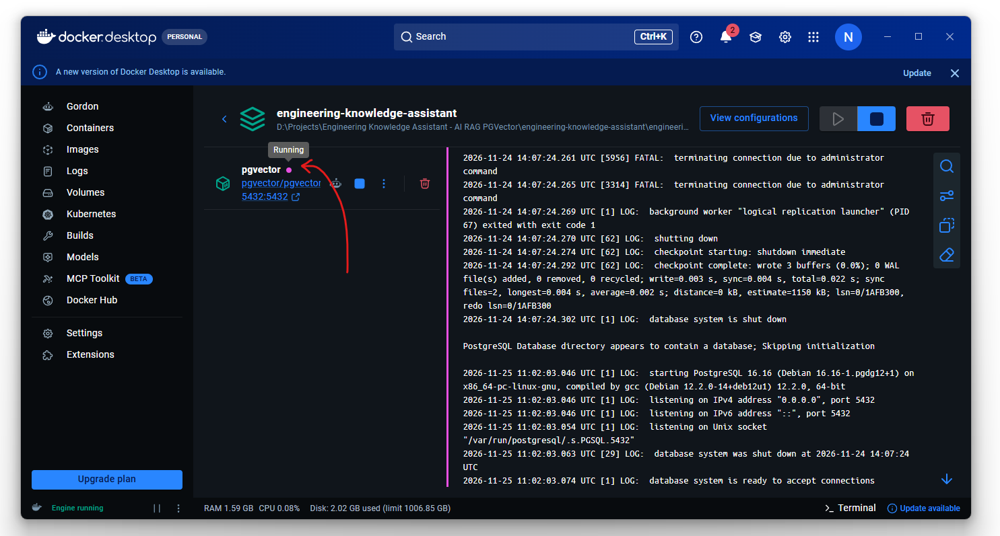
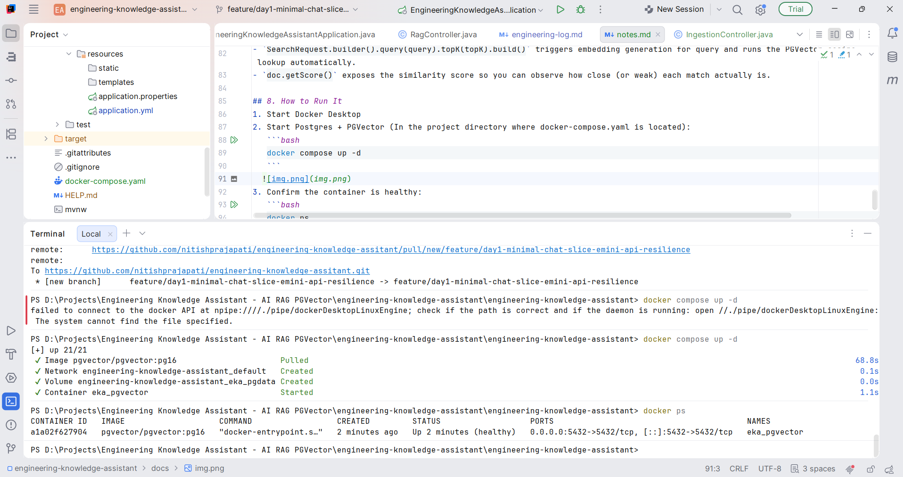
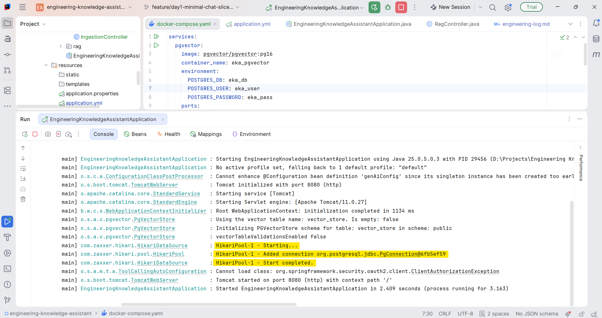
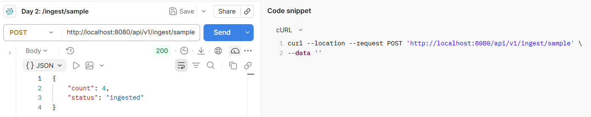
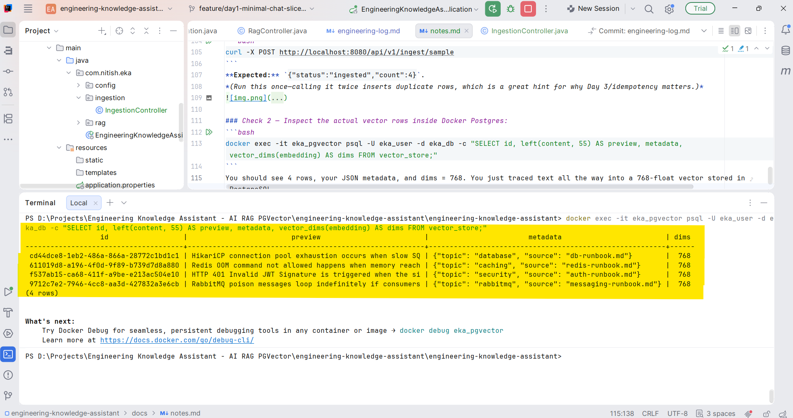
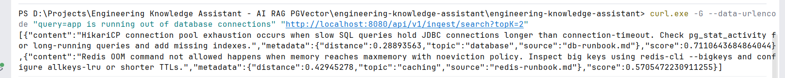
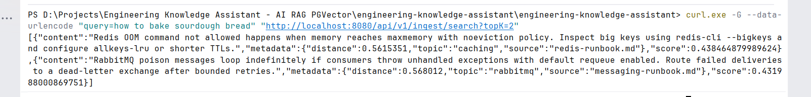

# Notes

## The Big Picture (What We Are Building & Why)

Imagine your company hires a brilliant consultant (Google Gemini). They know general Java, databases, and computer science, **but they have never seen your company's internal documents, error codes, or troubleshooting guides.** If an engineer asks them *"Why is our Pune payments service throwing Error 504?"*, they will either guess blindly or give generic internet advice.

We are building an **Engineering Knowledge Assistant**: an internal backend service where engineers upload their team's troubleshooting guides, and anyone can ask questions and get accurate answers **backed by those exact documents.**

## Some concepts -
### **1. What is RAG?**
<br>**RAG = Retrieval-Augmented Generation.** 
<br>In very simple language, it means giving an AI an open-book test instead of making it memorize everything.
- **Without RAG (Closed-book exam):** You ask Gemini a question about your company's app. It has to guess from memory and makes things up.
- **With RAG (Open-book exam):**
  - **Retrieval (Search):** Your Spring Boot app searches your Postgres database and pulls out the 2-3 most relevant paragraphs from your company's manuals.
  - **Augmented (Attach):** Your app pastes those 2-3 paragraphs right into the prompt alongside the user's question. 
  - **Generation (Answer):** Gemini reads only those attached paragraphs and writes a clear answer in plain English.
That's the entire mystery of RAG. It is just Database Search + Copy-Paste into Prompt + Ask AI.


---

# Day 1: Basic Gemini LLM Integration & Spring AI Setup
**In short on what we did on day 1:**

> What Day 1 was for (The Talking Brain): We connected your Spring Boot app to the brilliant consultant (Gemini Chat). We asked a general question over HTTP, and Gemini answered. Zero database, zero company documents. We just proved *"my Java app can reliably talk to an AI over the internet."*

## 1. Objective
   Bootstrap a Java 25 Spring Boot application, integrate the Spring AI Google GenAI dependency, configure your Gemini API key securely, and expose a basic REST endpoint to chat with the model.

## 2. Why this feature exists
   This establishes the foundational HTTP communication between your backend and the LLM. You must verify that your Spring Boot application can successfully authenticate and exchange tokens with Gemini before adding the complexity of databases and documents.

## 3. Essential Concepts

- **API Key Management:** API keys should never be committed to Git. They are injected at runtime via environment variables. 
- **Spring AI ChatClient:** A fluent builder interface that abstracts away the specific provider (Gemini). If you switch to OpenAI later, your Java code remains identical; only the dependency and YAML config change. 
- **Model Selection:** `gemini-4-hydrogen` (fallback to `gemini-3.5-flash-lite`, which is optimized for fast, low-latency text responses on the free tier.)

---

# Day 2: Docker Compose, PGVector, Embeddings & First Semantic Search
**In short on what we did on day 2:**
> What Day 2 was for (The Smart Filing Cabinet): We set up a local PostgreSQL database that understands meaning, not just exact word matches. We saved 4 tiny sample troubleshooting notes inside it and proved that searching *"running out of database connections"* finds the *"HikariCP pool exhaustion"* note, even though zero words matched.
## 1. Objective
   Run PostgreSQL with the PGVector extension in Docker Compose, wire Spring AI's Google GenAI embedding model (`gemini-embedding-001`) and `VectorStore`, store 4 sample engineering notes as 768-dimensional vectors, inspect the stored rows directly in SQL, and verify semantic search against queries that share zero exact keywords.
## 2. Why This Feature Exists
Relational databases (`LIKE`, B-tree indexes) and traditional full-text search match words, not meaning. An engineer searching for `"database connections running out"` will miss a runbook titled `"HikariCP pool exhaustion"` if you rely on keyword matching alone. Embeddings convert text into numeric coordinates representing meaning, and PGVector lets PostgreSQL index and search those coordinates inside the same relational engine you already know.
## 3. Essential Concepts
### A. Embeddings & Semantic Search
- **What an embedding represents:** A fixed-length array of floating-point numbers (a vector) encoding the semantic meaning of a piece of text. 
- **How text becomes a vector:** Your app sends text to an embedding model (`gemini-embedding-001`), which returns a numeric vector rather than a chat reply. 
- **Why similar meaning lands nearby:** Embedding models are trained on massive text corpora so passages used in similar contexts produce vectors pointing in similar directions. 
- **Keyword search vs. semantic search:**

| Dimension | Keyword Search (`ILIKE` / Full-Text) | Semantic Search (Embeddings + PGVector) |
| :--- | :--- | :--- |
| **Matches on** | Exact words or word stems | Conceptual meaning |
| **Finds synonyms?** | No (`"pool exhausted"` misses `"out of connections"`) | Yes |
| **Finds exact error codes?** | Excellent (`ERR_CONN_5041`) | Weak (arbitrary codes carry little linguistic meaning) |
| **Compute cost** | Very low (local DB only) | Higher (embedding API call + vector distance scan) |

- **Dimensions & compatibility:** `gemini-embedding-001` defaults to 3,072 dimensions and supports truncating to 768 or 1,536 via Matryoshka Representation Learning. Hard rule: The model, dimension count, and PGVector column size (`vector(768)`) must match across ingestion and querying. If you later switch embedding models or change dimensions, every stored vector becomes incompatible and must be re-embedded from scratch.   
- **Similarity metrics (Cosine Distance):** Cosine measures the angle between two vectors, ignoring vector length/magnitude. Because truncated vectors from `gemini-embedding-001` (e.g., 768 instead of 3,072) are not auto-normalized by Google, COSINE_DISTANCE is the safe metric to use.
- **How similarity search works:** Your query text is embedded with the same model → PGVector uses an HNSW index (an approximate nearest-neighbor graph) to locate the closest stored vectors → Spring AI returns the `topK` closest `Document` objects along with a similarity score (`0.0` to `1.0`, higher means closer).

### B. Docker Fundamentals
- **Image:** Read-only blueprint (`pgvector/pgvector:pg16`). 
- **Container:** Running instance created from an image (`eka_pgvector`). 
- **Port mapping (`5432:5432`):** `<host-port>:<container-port>` exposes the container's Postgres port to your local JVM. 
- **Volume (`eka_pgdata:/var/lib/postgresql/data`):** Persistent storage managed by Docker so database rows survive container restarts (`docker compose down`). Passing -v deletes the volume.
- **Environment variables:** Pass initial DB credentials (`POSTGRES_DB`, `POSTGRES_USER`, `POSTGRES_PASSWORD`) without baking them into the image. 
- **Docker Compose:** Declarative YAML file to start and stop all local infrastructure with one command.

## 4. Architecture & Data Flow
```
WRITE PATH (Seed Sample Docs):
POST /api/v1/ingest/sample
  --> VectorStore.add(List<Document>)
    --> Google GenAI Embedding API (gemini-embedding-001, 768 dims)
      --> INSERT INTO vector_store (id, content, metadata, embedding)

READ PATH (Semantic Search):
GET /api/v1/ingest/search?query=database+connections+running+out&topK=2
  --> VectorStore.similaritySearch(SearchRequest)
    --> Google GenAI Embedding API (query text -> 768-dim query vector)
      --> PGVector HNSW Cosine Similarity Query
        --> Top-K Documents (text + metadata + similarity score)
```

## 5. Prerequisites
- Day 1 compiles and returns answers from `GET /api/v1/rag/ask`. 
- Docker Desktop is open and running. 
- `GEMINI_API_KEY` is configured in your shell or IntelliJ Run Configuration. 
- Port `5432` is free on your machine (or note the `5433` adjustment in Section 10 below).

## 6. Dependencies and Configuration
- pom.xml — `spring-ai-starter-model-google-genai-embedding`, `spring-ai-starter-vector-store-pgvector`, `postgresql`
- docker-compose.yml
- application.yml — `spring.datasource`, `embedding`, `vectorstore.pgvector`
- **Why `embedding.api-key` is still needed even with `GenAiConfig`:** 
`GoogleGenAiTextEmbeddingAutoConfiguration` builds its own `GoogleGenAiEmbeddingConnectionDetails` bean from `spring.ai.google.genai.embedding.api-key` rather than reusing your chat `Client` bean.
## 7. Implementation Instrutions
IngestionController
- We put Day 2's seed and search verification endpoints directly in ingestion/ so there are no throwaway packages

**Key things to notice:**
- `VectorStore` is an interface—your controller never imports `PgVectorStore` or `GoogleGenAiTextEmbeddingModel` directly.
- `new Document(text, metadata)` pairs raw text with structured JSON metadata (`source`, `topic`) that we will later return as citations.
- `SearchRequest.builder().query(query).topK(topK).build()` triggers embedding generation for query and runs the PGVector cosine lookup automatically.
- `doc.getScore()` exposes the similarity score so you can observe how close (or weak) each match actually is.   

## 8. How to Run It
### 1. **Start Docker Desktop**

### 2. **Start Postgres + PGVector** 
   (In the project directory where docker-compose.yaml is located):
   ```bash
   docker compose up -d
   ```


### 3. **Confirm the container is healthy:**
   ```bash
   docker ps
   ```
   Wait until `STATUS` shows `(healthy)`.
   


### 4. **Start Spring Boot** 
   ...from IntelliJ or terminal (`./mvnw spring-boot:run`).
   

## 9. How to Verify It Works (Run All 4 Checks)
### Check 1 — Seed the 4 sample notes:
```bash
curl -X POST http://localhost:8080/api/v1/ingest/sample
```
**Expected:** `{"status":"ingested","count":4}`. 
*(Run this once—calling it twice inserts duplicate rows, which is a great hint for why Day 3/idempotency matters.)*


### Check 2 — Inspect the actual vector rows inside Docker Postgres:
```bash
docker exec -it eka_pgvector psql -U eka_user -d eka_db -c "SELECT id, left(content, 55) AS preview, metadata, vector_dims(embedding) AS dims FROM vector_store;"
```
You should see 4 rows, your JSON metadata, and dims = 768. You just traced text all the way into a 768-float vector stored in PostgreSQL.


###  Check 3 — Semantic match with ZERO shared keywords:
```bash
curl -G --data-urlencode "query=app is running out of database connections" "http://localhost:8080/api/v1/ingest/search?topK=2"
```
**Expected:** 
The db-runbook.md (HikariCP) note ranks #1 with the highest score, even though "HikariCP" and "exhaustion" are not in your query.


### Check 4 — Deliberate failure test (observe similarity search's limitation):
```bash
curl -G --data-urlencode "query=how to bake sourdough bread" "http://localhost:8080/api/v1/ingest/search?topK=2"
```
Notice that PGVector still returns 2 engineering notes, just with a lower score! Record the scores from Check 3 vs. Check 4—this proves why topK alone causes hallucinations if you don't enforce a similarityThreshold and grounding rules (Day 5).


### Dev Testing Observations
Our Day 2 numbers worked exactly as intended. Look at the gap between your two tests:
- **Relevant query** (``"app is running out of database connections"``): Matched `db-runbook.md` (HikariCP) at score `0.71` (`distance: 0.29`). 
- **Irrelevant query** (``"how to bake sourdough bread"``): Best match in the database was Redis at score `0.44` (`distance: 0.56`).

Notice the simple math Postgres just did: `score = 1 - distance` (`1 - 0.29 = 0.71`). Closer to `1.0` means closer in meaning. That gap between `0.71` and `0.44` is how we will later stop the AI from answering nonsense questions.

## 10. Common Errors and Debugging Steps
- **Port `5432` already in use:** Stop your local Postgres service, or map `"5433:5432"` in `docker-compose.yml` and change `spring.datasource.url` to `jdbc:postgresql://localhost:5433/eka_db`. 
- **Startup fails asking for Vertex AI project ID / location:** Confirm `spring.ai.google.genai.embedding.api-key: ${GEMINI_API_KEY}` is indented directly under `embedding:` (not under `text:`). 
- `ERROR: expected 1536 dimensions, not 768` (or vice versa): Both `spring.ai.google.genai.embedding.text.dimensions` and `spring.ai.vectorstore.pgvector.dimensions` must be `768`. If a mismatched table was already created, wipe the Docker volume cleanly with `docker compose down -v && docker compose up -d` and restart the app. 
- `400` / batch error on `vectorStore.add(docs)`: If Gemini's free-tier endpoint rejects a multi-item batch, temporarily loop `docs.forEach(doc -> vectorStore.add(List.of(doc)));` and tell me the exact stack trace so we document it in your ADR log. 
- Duplicate rows after calling `/sample` multiple times: Clear the table anytime with:
```bash
docker exec -it eka_pgvector psql -U eka_user -d eka_db -c "TRUNCATE TABLE vector_store;"
```